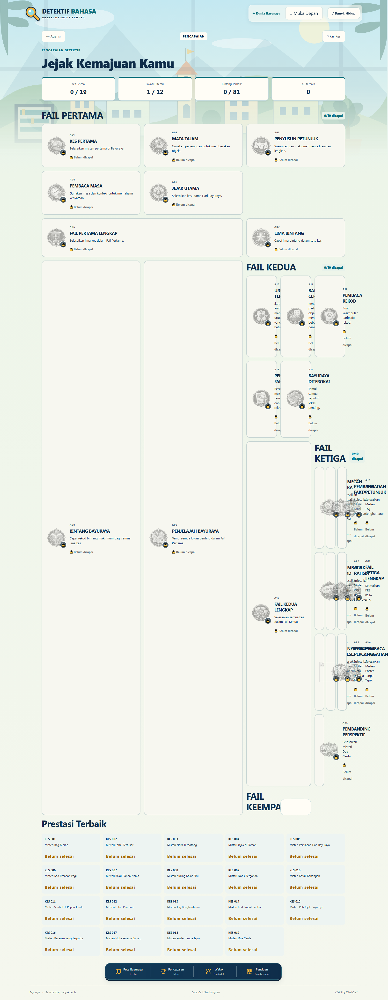
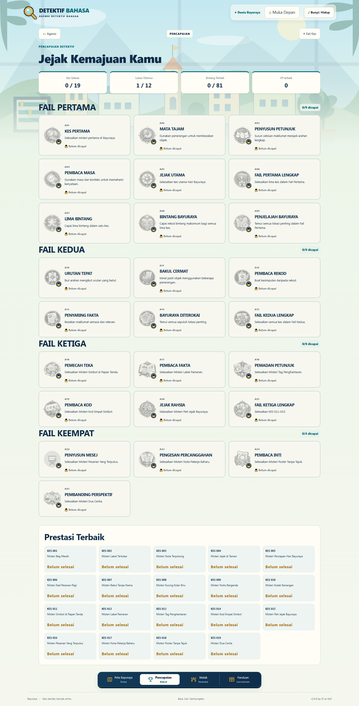
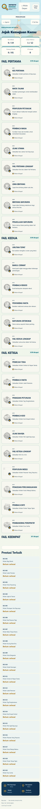
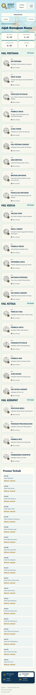

# Detektif Bahasa v2.4.6 — QA setempat

Tarikh: 16 Oktober 2026  
Status: **LOCKED**

## Punca sebenar

Renderer asal FAIL PERTAMA dan FAIL KEDUA dalam `arc2.js` membina seksyen beradik yang sah. Pembalut C017 dan C018 dalam `arc5.js` kemudian menggunakan regex yang bermula pada `.achievement-grid` pertama dan berakhir pada grid terakhir sebelum `records-section`. Penggantian itu membuang hanya satu pasangan penutup `
</section>`. Kesannya, seksyen FAIL KEDUA, FAIL KETIGA dan FAIL KEEMPAT menjadi anak langsung grid FAIL PERTAMA.

Pada skrin desktop, grid tiga lajur memperlakukan tajuk seksyen dan grid bersarang itu sebagai item grid. A08/A09 turut terkesan oleh aturan `.achievement-hero { grid-column: span 2 }`. Gabungan kedua-dua perkara menghasilkan kad sangat tinggi, seksyen sebelah-menyebelah, trek sempit dan limpahan mendatar. Pada skrin kecil, aturan satu lajur menyamarkan struktur DOM yang rosak.

## Pembaikan

- `renderAchievements()` akhir kini membina empat seksyen saudara secara langsung.
- Setiap `.achievement-section` mempunyai tajuk, kiraan terbitan daripada keadaan sebenar, dan `.achievement-grid` sendiri.
- Pembahagian 25 lencana kekal: 9 / 6 / 6 / 4.
- Semua kad menggunakan `grid-column:auto`; tiada kad merentasi lajur.
- Grid menggunakan `minmax(0,1fr)`: satu lajur hingga 599px, dua lajur 600–999px, dan tiga lajur mulai 1000px.
- Teks mempunyai pembalutan semula jadi dan kad boleh mengecil tanpa melepasi seksyen.
- Renderer lencana kini menghormati laluan aset yang telah dikonfigurasi. Ini memulihkan SVG A22 tanpa menukar karya seni.
- Kunci simpanan kekal `detektif-bahasa-v1`; tiada migrasi atau pengiraan semula pencapaian.

## Bukti visual

### 1600×900 sebelum

### 1600×900 selepas

### 390×844 sebelum

### 390×844 selepas

## QA geometri Chrome dan Edge

Setiap saiz diuji pada halaman sebenar dalam Chrome dan Edge. Semua semakan mengesahkan empat seksyen langsung, empat grid, 25 ID unik, tiada kad bertindih, kad kekal di dalam seksyen sendiri, susunan menegak betul, ruang kandungan kad melebihi ambang minimum, kiraan ringkasan sepadan dengan rekod, dan `scrollWidth` halaman sama dengan lebar viewport.

| Viewport | Lajur | Chrome | Edge |
|---|---:|---|---|
| 360×640 | 1 | Lulus | Lulus |
| 390×844 | 1 | Lulus | Lulus |
| 502×868 | 1 | Lulus | Lulus |
| 800×450 | 2 | Lulus | Lulus |
| 1024×768 | 3 | Lulus | Lulus |
| 1280×720 | 3 | Lulus | Lulus |
| 1366×768 | 3 | Lulus | Lulus |
| 1600×900 | 3 | Lulus | Lulus |
| 1920×1080 | 3 | Lulus | Lulus |

Laporan geometri penuh disimpan dalam `docs/v2.4.6-geometry.json`.

## Aliran resize dan navigasi

Dalam kedua-dua pelayar:

- 1100×700 → 1600×900 → 1100×700 → 1600×900 diulang tiga kali;
- muat semula ketika 1600×900;
- skrol dari FAIL PERTAMA hingga FAIL KEEMPAT dan kembali ke atas;
- kembali ke Agensi dan buka Pencapaian semula;
- zum pelayar 125% diuji selepas matriks viewport.

Semua geometri kekal sah tanpa memerlukan muat semula pemulihan.

## Ujian automatik dan regresi

- `node --check game.js` — lulus.
- `node --check arc5.js` — lulus.
- `node --check lensa.js` — lulus.
- `node --check server.js` — lulus.
- `node test-game.cjs` — lulus, termasuk struktur empat seksyen, pengelompokan 9/6/6/4, A01–A25 tepat sekali, aset A22, kunci simpanan dan regresi C001–C019.
- `git diff --check` — lulus.
- Jumlah terkunci: 19 kes, 12 lokasi, 24 watak, 25 pencapaian, 81 bintang maksimum dan 6470 XP terbaik maksimum.
- Semua 14 aktiviti Lensa Bahasa dan pembaikan v2.4.3–v2.4.5 kekal lulus.

Tiada commit, push, deployment atau QA Cloudflare dilakukan.
