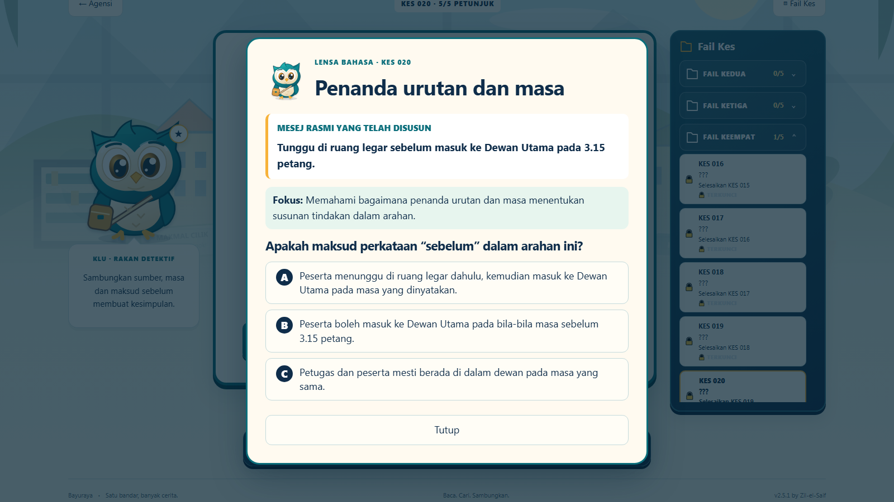
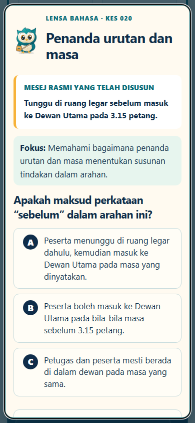

# Detektif Bahasa v2.5.1 — QA setempat

Tarikh: 17 Oktober 2026  
Status: **LOCKED LOCAL QA**

## Punca sebenar

Satu aksara `+` tersasar berada tepat sebelum blok CSS Lensa Bahasa. Pelayar mentafsir aturan pertama sebagai pemilih relatif `+ .lensa-dialog`, lalu aturan overlay tidak pernah sepadan. Pemeriksaan Chrome pada 1600×900 mengesahkan `.lensa-dialog` menjadi `position: static`, dipasang di dalam `#app`, bermula pada x=0 dan bergerak bersama susun atur halaman. Pembukaan turut mengubah `scrollY` daripada 84 kepada 775 dalam reproduksi asal.

## Pembaikan

- Aksara tersasar dibuang dan overlay menggunakan `position:fixed; inset:0`.
- Overlay Lensa dipasang terus di bawah `document.body`, di luar susun atur kes.
- Kad menggunakan lebar maksimum 720px dan `max-height` berasaskan `100dvh`, dengan sandaran `100vh`.
- Kandungan panjang menatal dalam `.lensa-card`; backdrop tidak menatal.
- `html` dan `body` dikunci semasa modal terbuka dan dilepaskan ketika ditutup.
- Kedudukan skrol direkod sebelum buka dan dipulihkan selepas fokus dikembalikan dengan `preventScroll`.
- Pembukaan dan jawapan hanya mengganti overlay; halaman kes tidak dirender semula.
- Focus trap, Escape, `aria-modal`, tajuk boleh capai dan pemulangan fokus dikekalkan.
- Pendengar klik diletakkan sekali pada `document` kerana overlay kini berada di luar `#app`.

## Sebelum dan selepas

Sebelum: overlay dilaporkan sebagai `position: static`; dialog 720px melekat pada kiri dan bahagian bawah melepasi viewport.

Selepas pada 1600×900: backdrop ialah 1600×900 pada (0,0); dialog ialah 720×766 pada x=440, y≈67, berpusat dan berada sepenuhnya dalam viewport. `scrollY` tidak berubah ketika dibuka atau selepas ditutup.

## QA pelayar

Chrome dan Edge sebenar diuji dalam kedudukan halaman yang telah ditatal, dengan gerakan dikurangkan.

| Viewport | Chrome | Edge |
|---|---|---|
| 360×640 | Lulus | Lulus |
| 390×844 | Lulus | Lulus |
| 430×932 | Lulus | Lulus |
| 800×450 | Lulus | Lulus |
| 1024×768 | Lulus | Lulus |
| 1366×768 | Lulus | Lulus |
| 1600×900 | Lulus | Lulus |
| 1920×1080 | Lulus | Lulus |

Setiap ukuran mengesahkan backdrop menutup viewport, dialog berada dalam viewport dan berpusat secara mendatar, tiada limpahan mendatar, hanya satu modal wujud, serta skrol latar dikunci. Saiz 800×450 dan simulasi tetingkap 1280×720 pada zum 125% mengesahkan skrol dalaman dan tindakan bawah boleh dicapai.

Urutan maximize/restore 1366→1920→1600→1366→1600 lulus dalam kedua-dua pelayar. Ujian sentuhan pada 390×844 berjaya menjawab dan menutup aktiviti. Klik pada backdrop tidak mengaktifkan kawalan `#app`.

## Aksesibiliti

- Fokus masuk ke kad dialog ketika dibuka.
- Tab dan Shift+Tab dikekang dalam dialog.
- Escape menutup modal.
- Fokus kembali kepada butang Lensa asal tanpa mengubah skrol.
- Enter, Space, tetikus dan sentuhan menggunakan kawalan butang semantik yang sama.
- `prefers-reduced-motion` dihormati.

## Regresi

- Semua 15 aktiviti C006–C020 dibuka dan ditutup melalui modal bersama.
- Soalan, jawapan, petikan, penjelasan dan syarat buka tidak berubah.
- C020 masih memerlukan sumber sebelum aktiviti `sebelum` dibuka.
- Tiada XP, bintang, petunjuk atau pencapaian diberi oleh Lensa.
- C001–C020, navigasi Muka Depan, simpanan lama, A26/A27 dan galeri 9/6/6/6 kekal lulus.
- Kunci simpanan kekal `detektif-bahasa-v1`; jumlah keluaran tidak berubah.

## Semakan

- `node --check game.js` — lulus.
- `node --check server.js` — lulus.
- `node --check lensa.js` — lulus.
- `node --check test-lensa-modal.cjs` — lulus.
- `node test-game.cjs` — lulus.
- `node test-lensa-modal.cjs` — lulus pada Chrome dan Edge.
- `git diff --check` — lulus.

Geometri terperinci disimpan dalam `docs/v2.5.1-lensa-geometry.json`. Tiada commit, push, deployment, pemadaman kemajuan atau QA Cloudflare dilakukan.
